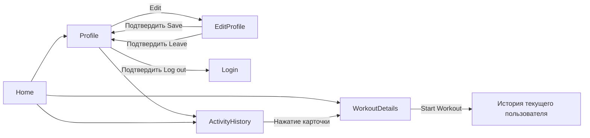

# Профиль, редактирование и история — краткая документация

## Что изменено

- Несколько локальных пользователей, простое хранение по email и обычному паролю.
- В меню двух точек профиля — один пункт **Log out**, с подтверждением.
- В Edit можно изменить фото, имя, пол, дату рождения, рост, вес и пароль.
- Перед сохранением — диалог **Save changes?**; перед выходом из Edit —
  **Leave without saving?**. Отмена сохраняет текущий черновик.
- После сохранения Profile обновляет возраст и данные; Home обновляет имя и BMI.
- View More в карточке BMI показывает Toast с формулой и подставленными значениями.
- Start Workout записывает запуск в историю и показывает Snackbar со ссылкой History.
- Activity History доступна из профиля и нижней панели Home/Profile. Это RecyclerView
  с карточками тренировок и датой/временем нажатия. Новые записи показываются первыми.
- Остальные пункты настроек по-прежнему показывают Toast.

## Поток экранов

## Основные классы

| Класс / метод | Назначение |
| --- | --- |
| `UserStorage` | Все аккаунты и история в `SharedPreferences("users")`. Схема и методы — в [UserStorage.md](UserStorage.md). |
| `ProfileActivity.ProfileAdapter` | RecyclerView: шапка пользователя, статистика, разделы настроек. |
| `ProfileActivity.showAccountMenu()` / `logout()` | Единственный пункт выхода, диалог, завершение сессии и открытие Login. |
| `EditProfileAdapter.Draft` | Значения и ошибки отдельно от ViewHolder: прокрутка не теряет ввод. Дата хранится в `birthDate`. |
| `Draft.error()` / `firstError()` | Проверка одного поля / поиск первого ошибочного поля. |
| `EditProfileActivity.chooseBirthDate()` | MaterialDatePicker, запрещающий будущие даты. Выбранная дата отображается в UTC. |
| `confirmSave()` / `saveProfile()` | Проверка полей, подтверждение, сохранение в фоне и возвращение в Profile. |
| `confirmExit()` | Подтверждение выхода без сохранения для верхней стрелки и системной кнопки Back. |
| `ProfilePhotos` | Импорт, уменьшение, EXIF-поворот и хранение фотографий. |
| `ProfileUi` | Системные отступы и проверка текущей сессии для экранов. |
| `WorkoutDetailsActivity` | Обработчик Start Workout фиксирует время и вызывает `addWorkout()`. |
| `ActivityHistoryActivity` | Загружает историю пользователя и показывает список либо пустое состояние. |
| `WorkoutHistoryAdapter` / `WorkoutHistoryItem` | Карточки и данные истории; нажатие карточки открывает тот же план. |

## Валидация

Имя непустое; пол Male/Female; дата рождения не в будущем; рост 50–250 см,
вес 20–300 кг. Новый пароль можно не заполнять. Для смены нужны правильный текущий
пароль и совпадающий повтор нового. Правило нового пароля: ровно 8 символов,
5–7 цифр и 1–3 ASCII-спецсимвола, без букв и пробелов.

Ошибки обновляются при вводе. После отмены Save данные не записываются.
При пересоздании Edit сохраняются обычные поля, дата и выбранное фото; пароли
в Bundle не записываются и вводятся заново.

## Фото и ресурсы

Галерея: `GetContent`. Камера: `TakePicture` и FileProvider.
Временный снимок — `cache/profile_camera/camera_<число>.jpg`, обработанное фото —
`files/avatars/avatar_<число>.jpg`. В профиле хранится только имя файла.
Стандартные PNG выбираются по полу, загруженная фотография при смене пола остаётся.

Оригиналы SVG — `design-assets/profile/`, VectorDrawable — `res/drawable/`,
два стандартных аватара — `res/drawable-nodpi/`. Градиенты иконок сохранены.

## Проверка

Сборка: `gradlew.bat assembleDebug assembleDebugAndroidTest lintDebug --offline`.
Инструментальные тесты `UserStorageTest` и `ProfilePhotosTest` проверяют аккаунты,
историю, даты, пароли, черновик и импорт фотографий в отдельных preferences.
